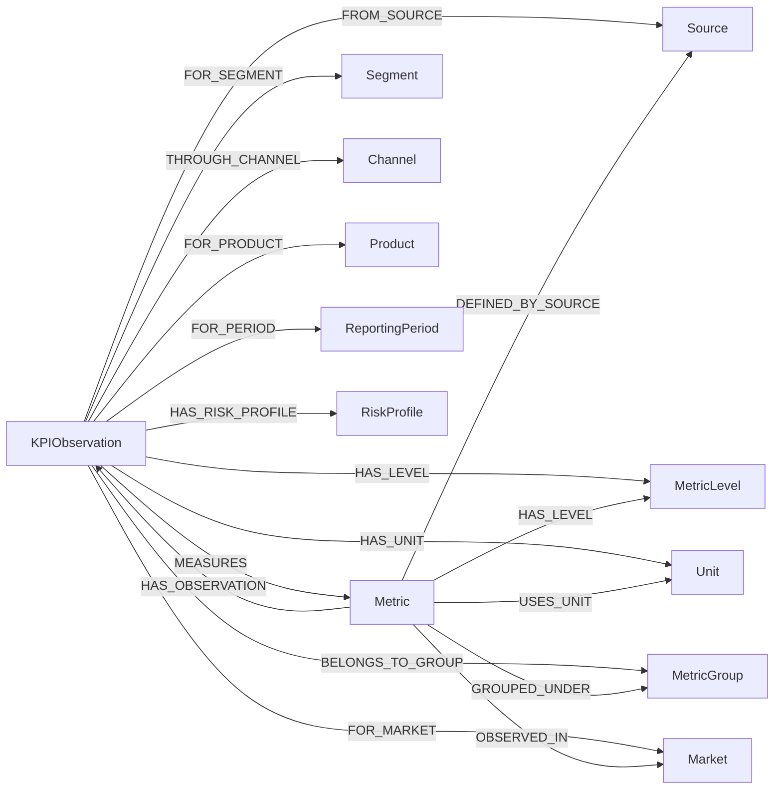

# Enterprise KPI ontology

This graph answers what a KPI row means. It does not mirror the BigQuery table one column per node.

The center of the model is a `KPIObservation`: one reported measurement of one metric, in one market, segment, channel, product, and corridor context, for one reporting month, from one business source. Dimensions that can be reused are nodes. Numbers that only describe that measurement stay properties.

`Channel`, `Product`, `MetricGroup`, `RiskProfile`, and a future `Corridor` are connected only when the source value is present.

## Why the observation is the fact

`Active Customers` is one business definition. India in August 2025 and Taiwan in August 2025 are two observations of that definition. A later month becomes a third observation of the same metric. The metric id does not contain a date, a market, or a channel.

## Why dimensions are nodes

Market, segment, channel, product, source, period, level, unit, and group are the things a future query needs to traverse. `INDIA` is a market node. It is not a property buried inside nine unrelated fact rows, and it is not inferred to be the same thing as `INM`.

## Why measurements stay properties

`mtd_actual`, `mtd_plan`, `ytd_actual`, `ytd_plan`, `py_*`, `fy_forecast`, `fy_plan`, `mom`, `pm_actual`, `vs_plan`, `vs_py`, and `vs_ye_target` are values of one observation. Turning each number into a node would add graph size without adding a reusable business concept.

Prior-year and previous-month figures are attributes of the current row. They are not separate observations, because the extract does not supply a full prior-period grain. When a real prior month is loaded, it becomes its own `KPIObservation` on its own `ReportingPeriod`.

## Two kinds of relationship

| Origin | Meaning |
| --- | --- |
| `SOURCE_FACT` | The row states this context. Example: this observation is for India. |
| `SOURCE_PROJECTION` | The same source column, lifted onto the reusable metric. Example: Active Customers is reported at L1. |
| `DERIVED` | A convenience edge projected from the facts. `Metric-[:OBSERVED_IN]->Market` and `Metric-[:HAS_OBSERVATION]->KPIObservation`. |

Derived edges are marked `origin = 'DERIVED'` and `basis = 'KPIObservation'`. They are not new business facts.

## What this model refuses to invent

- No region, country, or cluster above a market.
- No equivalence between `INDIA` and `INM`, or any other market code.
- No ISO currency for `$`.
- No `UNKNOWN` channel or product when the source value is null.
- No breach calculation. `SQ_BREACH_CODE` is stored as reported, including `NA`.
- No recomputation of `vs_plan`, `vs_py`, or `mom`.
